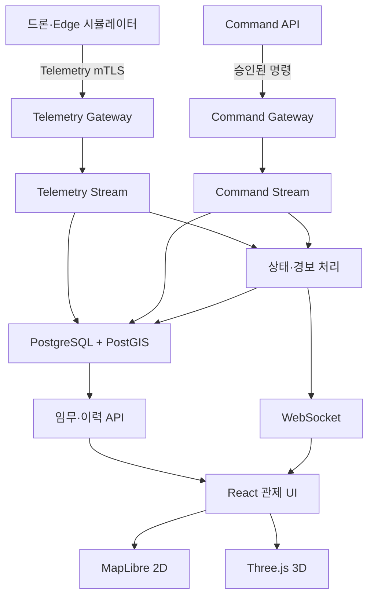

# AeroOps 종합 기획서

## 프로젝트 정의

AeroOps는 가상 드론 10대의 위치·자세·기체 상태를 실시간 수집하고, 운영 명령을 별도 신뢰 채널로 전달하여 승인·취소·타임아웃까지 추적하는 관제 플랫폼이다. 전체 기체는 2D 지도에 심벌로 표시하고 선택 기체만 3D 모델로 상세 표현한다. 패킷 손실·지연·역순·통신 단절을 재현하고, 기체별 인증서 및 배포 버전과 운용 로그를 연결한다.

[[01_프론트엔드_아키텍처]]
[[02_백엔드_아키텍처]]
[[03_데이터베이스_아키텍처]]
[[04_인프라_네트워크_클라우드]]
[[05_데이터엔지니어링_아키텍처]]

## 목표 직무

- 드론·무인체계 관제 SW
- 지휘통제·임무계획 백엔드
- 실시간 텔레메트리 데이터 플랫폼
- GIS 기반 운영 시스템

## 핵심 기능

1. 다중 드론 텔레메트리 생성·수집
2. 2D 위치·방향·경로·상태 관제
3. 임무·경로·지오펜스 관리
4. 배터리·통신·구역 이탈 경보
5. 선택 기체의 roll·pitch·yaw 3D 표현
6. 2D·3D·차트 동기화 이력 재생
7. 역할 기반 접근 제어와 감사 로그
8. 처리량·지연·오류 관측
9. Command와 Telemetry의 논리·권한·전송 채널 분리
10. 명령 승인·취소·타임아웃·중복 실행 방지
11. 단절 후 기체·서버 상태 재동기화
12. 이벤트 재생과 배포 버전 기반 장애 재현

## 전체 구조

## 기술 스택

| 영역 | 기술 |
|---|---|
| 프론트 | React, TypeScript, Vite, MapLibre, Three.js |
| 백엔드 | FastAPI, Pydantic, WebSocket, 명령 상태 머신 |
| 이벤트 | Redis Streams의 Command/Telemetry 분리 스트림 |
| 데이터 | PostgreSQL, PostGIS |
| 관측성 | Prometheus, Grafana |
| 실행 | Docker Compose, GitHub Actions |

## 성공 기준

- 10대 × 1 Hz를 20분 이상 안정 처리
- 수집부터 화면 반영까지 로컬 p95 500 ms 이내
- 중복·역순·범위 오류 메시지 판별
- 2D 위치와 3D 자세의 타임스탬프 동기화
- 통신 단절 시 마지막 위치와 수신 시각 보존
- 주요 변경 행위 감사 기록
- 패킷 손실·지연·역순 주입 시 정책대로 처리
- 단절 후 snapshot과 sequence 기반 재동기화 성공
- 인증서가 없거나 폐기된 기체의 연결 거부
- 운용 세션에서 실행 이미지·Git SHA·스키마 버전 조회

## 명령 수명주기

`DRAFT → PENDING_APPROVAL → APPROVED → DISPATCHED → ACKNOWLEDGED → EXECUTING → SUCCEEDED/FAILED/TIMED_OUT/CANCELLED`

- 위험 명령은 요청자와 승인자를 분리한다.
- `command_id`와 idempotency key로 중복 실행을 막는다.
- 취소는 별도 명령 이벤트이며 이미 완료된 작업을 되돌렸다고 간주하지 않는다.
- timeout은 전달 실패, ACK 지연, 실행 초과를 구분한다.

## 신뢰성 시나리오

| 상황 | 기대 동작 |
|---|---|
| Telemetry 손실 | sequence gap 기록, 최신 상태는 유지 |
| 지연·역순 | 원본 보존, latest_state 후퇴 방지 |
| Command ACK 손실 | 동일 command_id 재조회, 무조건 재실행 금지 |
| 통신 단절 | STALE 전환, 명령 제한, 마지막 수신 시각 표시 |
| 재연결 | 인증서 검증 후 snapshot·sequence·미종결 명령 대조 |
| 장애 분석 | 이벤트와 배포 버전으로 당시 상태 재생 |

## 제외 범위

실제 기체 제어, SLAM, 군집제어, 실시간 영상 AI, CAD급 모델링, Kubernetes는 MVP에서 제외한다.
