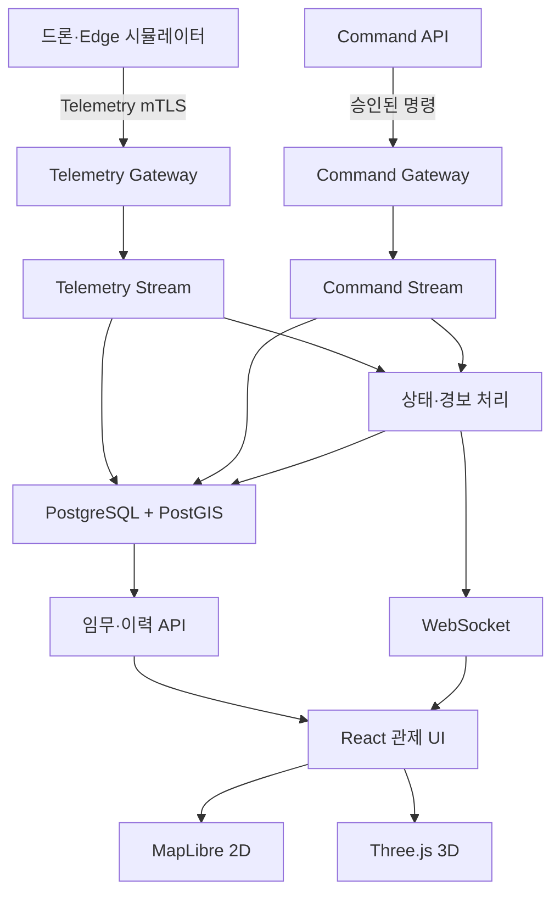

# AeroOps 종합 기획서

## 프로젝트 정의

AeroOps는 가상 드론 10대의 위치·자세·기체 상태를 실시간 수집하고, 운영 명령을 별도 신뢰 채널로 전달하여 승인·취소·타임아웃까지 추적하는 관제 플랫폼이다. 전체 기체는 2D 지도에 심벌로 표시하고 선택 기체만 3D 모델로 상세 표현한다. 패킷 손실·지연·역순·통신 단절을 재현하고, 기체별 인증서 및 배포 버전과 운용 로그를 연결한다.

시설 점검, 구역 감시, 재난 상황 확인과 같은 모의 임무를 대상으로 하며, 단순한 위치 시각화보다 불완전한 정보와 제한된 통신 조건에서 임무 상태를 판단하고 명령 결과를 검증하는 문제에 집중한다. 상세한 배경과 역량 목표는 `09_프로젝트_배경_해결문제_역량목표.md`를 기준으로 한다.

## 해결하려는 운용 문제

| ID | 운용 문제 | 핵심 설계 대응 |
|---|---|---|
| OPS-01 | 오래되거나 부분 갱신된 정보로 상태를 오판 | 필드별 Freshness, 품질 상태, `UNKNOWN` |
| OPS-02 | 통신 제약에서 임무 지속·중단 결정 | 사전 정의 Failsafe, 재접속 Reconciliation |
| OPS-03 | 다중 운영자의 권한·명령 충돌 | RBAC, 통제권 Lease, 상태 전이·동시성 제어 |
| OPS-04 | 명령 수락과 실제 목표 달성의 혼동 | ACK·실행·효과 검증 단계 분리 |
| OPS-05 | 기체 상태를 임무 수행 가능성으로 변환 | 에너지·경로·탑재체 기반 Mission Feasibility |
| OPS-06 | 제한된 통신·처리 자원의 우선 배분 | 채널 분리, QoS, Backpressure, 적응형 주기 |
| OPS-07 | 경보 폭증으로 핵심 사건을 놓침 | 중복 억제, 사건 Correlation, AI 근거 요약 |
| OPS-08 | 장애 당시 판단과 변경 이력 재구성 | 불변 이벤트, 버전 Lineage, Replay·Traceability |

## 목표 직무

- 드론·무인체계 관제 SW
- 지휘통제·임무계획 백엔드
- 실시간 텔레메트리 데이터 플랫폼
- GIS 기반 운영 시스템

## 핵심 기능

1. 다중 드론 텔레메트리 생성·수집
2. 2D 위치·방향·경로·상태 관제
3. 임무·경로·지오펜스 관리
4. 배터리·통신·구역 이탈 경보
5. 선택 기체의 roll·pitch·yaw 3D 표현
6. 2D·3D·차트 동기화 이력 재생
7. 역할 기반 접근 제어와 감사 로그
8. 처리량·지연·오류 관측
9. Command와 Telemetry의 논리·권한·전송 채널 분리
10. 명령 승인·취소·타임아웃·중복 실행 방지
11. 단절 후 기체·서버 상태 재동기화
12. 이벤트 재생과 배포 버전 기반 장애 재현
13. 규칙·통계·Isolation Forest 기반 통신·기체 이상 탐지
14. 로컬 LLM과 Hybrid RAG 기반 장애 분석·절차 검색
15. MLflow 기반 데이터·모델·프롬프트·평가 Lineage
16. SBOM·Artifact 서명·취약점 검사 기반 DevSecOps Gate

## 전체 구조

## 기술 스택

| 영역 | 기술 |
|---|---|
| 프론트 | React, TypeScript, Vite, MapLibre, Three.js |
| 백엔드 | FastAPI, Pydantic, WebSocket, 명령 상태 머신 |
| 이벤트 | Redis Streams의 Command/Telemetry 분리 스트림 |
| 데이터 | PostgreSQL, PostGIS |
| 관측성 | Prometheus, Grafana |
| 실행 | Docker Compose, GitHub Actions |
| AI | scikit-learn, llama.cpp, Sentence Transformers, pgvector |
| MLOps | MLflow Tracking, Model Registry, Replay Evaluation |
| DevSecOps | Gitleaks, SAST, Trivy, Syft, Cosign |

## 성공 기준

- 10대 × 1 Hz를 20분 이상 안정 처리
- 수집부터 화면 반영까지 로컬 p95 500 ms 이내
- 중복·역순·범위 오류 메시지 판별
- 2D 위치와 3D 자세의 타임스탬프 동기화
- 통신 단절 시 마지막 위치와 수신 시각 보존
- 주요 변경 행위 감사 기록
- 패킷 손실·지연·역순 주입 시 정책대로 처리
- 단절 후 snapshot과 sequence 기반 재동기화 성공
- 인증서가 없거나 폐기된 기체의 연결 거부
- 운용 세션에서 실행 이미지·Git SHA·스키마 버전 조회
- AI 서비스 중단 시 규칙 기반 Fallback 동작
- LLM 답변에서 근거 이벤트·문서·모델·프롬프트 버전 조회
- 승인되지 않거나 Hash가 다른 모델의 로딩 거부
- CI에서 Secret·Critical 취약점·미서명 Artifact 차단 증거

## 명령 수명주기

`DRAFT → PENDING_APPROVAL → APPROVED → DISPATCHED → ACKNOWLEDGED → EXECUTING → SUCCEEDED/FAILED/TIMED_OUT/CANCELLED`

- 위험 명령은 요청자와 승인자를 분리한다.
- `command_id`와 idempotency key로 중복 실행을 막는다.
- 취소는 별도 명령 이벤트이며 이미 완료된 작업을 되돌렸다고 간주하지 않는다.
- timeout은 전달 실패, ACK 지연, 실행 초과를 구분한다.

## 신뢰성 시나리오

| 상황 | 기대 동작 |
|---|---|
| Telemetry 손실 | sequence gap 기록, 최신 상태는 유지 |
| 지연·역순 | 원본 보존, latest_state 후퇴 방지 |
| Command ACK 손실 | 동일 command_id 재조회, 무조건 재실행 금지 |
| 통신 단절 | STALE 전환, 명령 제한, 마지막 수신 시각 표시 |
| 재연결 | 인증서 검증 후 snapshot·sequence·미종결 명령 대조 |
| 장애 분석 | 이벤트와 배포 버전으로 당시 상태 재생 |

## 제외 범위

실제 기체 제어, SLAM, 군집제어, 실시간 영상 AI, CAD급 모델링, Kubernetes, 기반 LLM 사전학습, 무장·표적화·공격 자동화는 MVP에서 제외한다.
