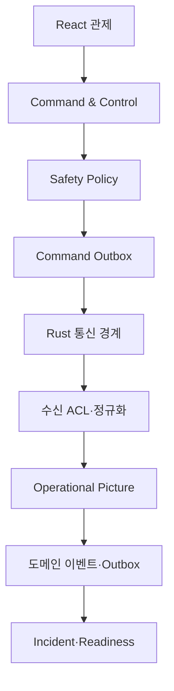

# 백엔드 아키텍처 — Kotlin·Spring Boot DDD

## 1. 구현 원칙

핵심 백엔드는 Kotlin/JVM과 Spring Boot 3로 구현한다. 초기 배포 형태는 Spring Modulith 기반 모듈러 모놀리스이며, 방산 운용 도메인의 경계를 코드·DB 소유권·이벤트 계약에 동일하게 반영한다. 향후 분리가 필요할 때에도 도메인 모델을 다시 나누지 않도록 경계 컨텍스트 간 직접 Repository 호출을 금지한다.

- 핵심 도메인은 Spring·JPA·통신 SDK를 모르는 순수 Kotlin으로 유지한다.
- Application 계층은 Use Case, 트랜잭션, 권한·정책 조합을 담당한다.
- Adapter 계층은 REST, WebSocket, Redis Streams, JPA, Rust Gateway 연동을 담당한다.
- 안전·명령 규칙은 LLM 결과나 UI 상태에 의존하지 않는다.
- JPA 업무 트랜잭션에 Reactive Stack을 혼용하지 않는다. 고빈도 수집은 Rust/C++ 경계에서 흡수하고 Kotlin Core에는 정규 이벤트를 전달한다.

## 2. 하위 도메인과 경계 컨텍스트

| 분류 | 경계 컨텍스트 | Aggregate·핵심 책임 |
|---|---|---|
| Core | Mission Operations | `Mission`, `Route`, `MissionPhase`, 임무 전이·중단·재배정 |
| Core | Command & Control | `Command`, `Approval`, `ControlLease`, 명령 수명주기·통제권·효과 검증 |
| Core | Operational Picture | `AssetState`, `Freshness`, `Track`, 관측 사실·추정·판단 불가 구분 |
| Core | Mission Readiness | `ReadinessAssessment`, 에너지·경로·탑재체 기반 수행 가능성 |
| Supporting | Communications Resilience | `LinkSession`, `SyncSession`, QoS·재접속·기록 대조 |
| Supporting | Safety & Policy | `FailsafePolicy`, `SafetyEnvelope`, Geofence, 정책 버전·허용 판정 |
| Supporting | Incident Management | `Incident`, `Alert`, 중복 억제·상관관계·조치 이력 |
| Generic | Identity & Audit | 사용자·기체 신원, RBAC, 불변 감사 기록 |
| Generic | Deployment Registry | 코드·이미지·스키마·정책·모델 버전과 운용 세션 연결 |

외부 장비·프로토콜 모델은 Anti-Corruption Layer에서 도메인 타입으로 변환한다.

## 3. 코드 구조

```text
backend/
├─ bootstrap/                       # Spring Boot 실행·조립
├─ shared-kernel/                   # ID, 시간, 좌표·단위 Value Object만
├─ mission-operations/
├─ command-control/
├─ operational-picture/
├─ mission-readiness/
├─ communications-resilience/
├─ safety-policy/
├─ incident-management/
├─ identity-audit/
└─ deployment-registry/
```

각 모듈 내부는 `domain`, `application`, `adapter-in`, `adapter-out` 패키지로 나눈다. 다른 모듈의 `domain` 또는 영속 Entity를 직접 참조하지 않고 공개 Application Port와 도메인 이벤트만 사용한다. ArchUnit과 Spring Modulith 검증으로 의존 규칙을 CI에서 차단한다.

## 4. 처리 흐름



## 5. Spring 기술 선택

| 관심사 | 선택 | 적용 기준 |
|---|---|---|
| API | Spring MVC, Bean Validation | 임무·명령·감사 트랜잭션 중심 |
| 실시간 화면 | Spring WebSocket | 최신 Projection·중요 이벤트 전송 |
| 모듈 경계 | Spring Modulith | 모듈 의존 검증·Application Event |
| 영속성 | Spring Data JPA, PostgreSQL/PostGIS | Aggregate 단위 저장, 낙관적 잠금 |
| Migration | Flyway | 컨텍스트별 경로·소유 테이블 구분 |
| 이벤트 | Transactional Outbox, Redis Streams | DB 상태와 발행 원자성 확보 |
| 보안 | Spring Security, OIDC/JWT | 역할·자원·통제권을 함께 검증 |
| 관측성 | Actuator, Micrometer, OpenTelemetry | Metric·Log·Trace 연계 |
| 시험 | JUnit 5, Kotest, Testcontainers, ArchUnit | 불변조건·통합·경계 검증 |

## 6. 명령 불변조건

- Dispatch 직전에 현재 권한, `ControlLease`, 운용 Session, 정책 버전, Asset State 신선도를 재검증한다.
- 상태 전이와 Outbox Event는 동일 DB 트랜잭션으로 기록한다.
- ACK 누락은 실패가 아니라 `ACK_TIMEOUT/UNKNOWN`으로 유지한다.
- 기체 수락, 실행 완료, 목표 상태 도달을 별도 사실로 기록한다.
- 낙관적 잠금과 idempotency key로 동시 승인·중복 실행을 막는다.
- 취소는 원 명령 이력을 지우지 않는 별도 Command/Event다.

## 7. 외부 언어 서비스 연동

| 구성요소 | 언어 | Kotlin Core와의 계약 |
|---|---|---|
| Edge Comms Agent·Gateway | Rust | versioned Protobuf/JSON, mTLS, sequence·session |
| Simulator·Codec·Replay | C++ | 동일 Wire Contract와 Scenario Manifest |
| AI·MLOps Service | Python | 읽기 전용 사건/Feature 입력, 근거 포함 분석 결과 |
| Ops Agent·Release Controller | Go | health/metric 수집, 서명·digest 배포 검증 API |

Python AI 서비스에는 Command 발행 Credential을 부여하지 않는다. AI의 `CommandProposal`은 분석 산출물일 뿐이며 Kotlin C2 Core의 요청·정책·승인 절차를 통과해야 한다.

## 8. 장애 정책

- Python AI 장애: 규칙 기반 판정과 관제·명령 기능 유지
- Rust Gateway 장애: 새 Dispatch 제한, 미종결 명령을 `UNKNOWN`으로 보존
- Redis 장애: DB Outbox 보존, 위험 명령 Dispatch 제한
- PostgreSQL 장애: 새 명령·승인 전이를 중단하고 Edge의 사전 정의 Failsafe 유지
- 재연결: 인증 → boot/session → 마지막 sequence → snapshot → 미종결 명령 → 충돌 정책 순으로 조정
