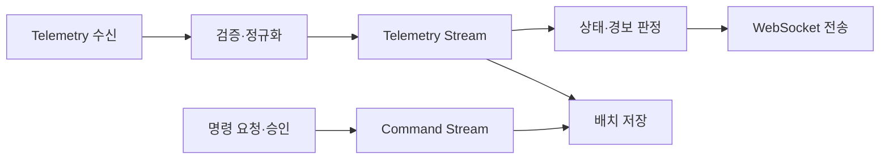

# 백엔드 아키텍처

## 모듈

| 모듈 | 책임 |
|---|---|
| Ingestion | 스키마·범위 검증, 중복 판별, 이벤트 발행 |
| Telemetry | 최신 상태와 기간별 이력 조회 |
| Mission | 임무·경로·구역·상태 전이 |
| Alert | 배터리·통신·지오펜스 규칙 판정 |
| Realtime | WebSocket 연결·구독·재연결 지원 |
| Identity | 인증, 역할·권한 |
| Audit | 중요 명령과 설정 변경 기록 |
| Command | 요청·승인·전달·ACK·취소·타임아웃 상태 머신 |
| Device Identity | 기체 인증서 식별·상태·폐기 확인 |
| Synchronization | 재연결 handshake와 상태 대조 |
| Deployment | 실행 버전·설정·스키마·규칙 버전 등록 |

초기에는 단일 FastAPI 애플리케이션 내부의 모듈형 모놀리스로 구현한다. Redis와 DB만 별도 프로세스로 둔다.

## 처리 흐름

## API 범위

- `POST /telemetry`: 시뮬레이터 데이터 수신
- `GET /assets/{id}/latest`: 최신 상태
- `GET /assets/{id}/telemetry`: 기간별 이력
- `/missions`: 임무 CRUD와 상태 변경
- `/geofences`: 공간 구역 관리
- `/alerts`: 경보 조회·확인
- `/commands`: 생성·조회·승인·취소
- `/commands/{id}/ack`: 기체 ACK 수신
- `/devices/{id}/sync`: 재동기화 handshake
- `/deployments`: 운용 배포 버전 조회
- `/ws/operations`: 최신 상태와 경보 구독

## 신뢰성 규칙

- `asset_id + timestamp + sequence`로 중복을 판정한다.
- 원본 이벤트 시각과 서버 수신 시각을 모두 저장한다.
- 역순 데이터는 원본 보존 후 최신 상태 갱신 여부를 분리 판정한다.
- 오래 걸리는 분석을 요청 경로에서 실행하지 않는다.

## 채널 및 권한 분리

- Telemetry는 기체→서버 단방향 고빈도 데이터이며 유실 허용 정책을 가진다.
- Command는 서버→기체 저빈도 제어 의도이며 인증·승인·ACK·감사 추적이 필수다.
- Redis key/stream, 소비자 그룹, API endpoint, 서비스 권한을 각각 분리한다.
- MVP에서는 물리 브로커는 공유하되 ACL과 논리 채널을 분리한다.

## 명령 처리 규칙

- 상태 전이는 DB 트랜잭션과 outbox event로 함께 기록한다.
- 만료된 명령은 dispatch하지 않는다.
- ACK가 없을 때 기체의 처리 여부를 확인하기 전 자동 재실행하지 않는다.
- 취소 요청은 원 명령과 별도 이벤트로 저장한다.
- timeout worker가 승인·전달·ACK·실행 단계별 기한을 판정한다.

## 재동기화

재연결 시 기체 인증 → 마지막 telemetry sequence → 기체 상태 snapshot → 미종결 command 목록 → 서버 상태 비교 → 충돌 정책 적용 순으로 수행한다.
