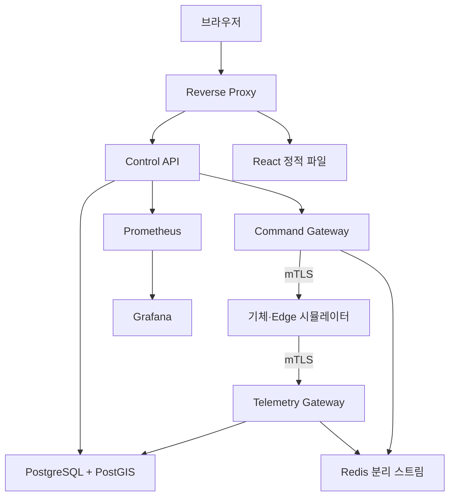
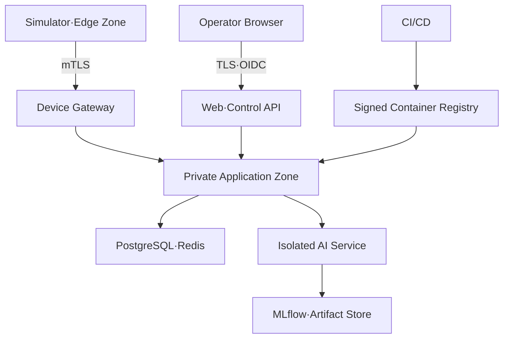

# 인프라·네트워크·클라우드 아키텍처

## 로컬 구성

Docker Compose 서비스는 `web`, `control-api`, `telemetry-gateway`, `command-worker`, `simulator`, `postgres`, `redis`, `prometheus`, `grafana`, `reverse-proxy`로 구성한다. 노트북 부담이 크면 gateway와 worker는 동일 이미지의 다른 실행 모드로 둔다.

## 네트워크 경계

- 외부 노출은 reverse proxy 하나로 제한한다.
- DB와 Redis는 내부 네트워크에서만 접근한다.
- 브라우저 요청과 WebSocket은 TLS 종단을 거친다.
- 서비스 계정과 사용자 계정을 분리하고 최소 권한을 적용한다.
- 비밀값은 저장소에 커밋하지 않고 환경별 secret으로 주입한다.
- 기체마다 별도 client certificate를 발급하고 인증서 fingerprint를 장비 ID와 연결한다.
- 인증서 만료·폐기 목록을 확인하며, 서버 인증서 검증을 생략하지 않는다.
- Command와 Telemetry 계정·ACL을 분리하여 telemetry 발행자가 명령을 발행하지 못하게 한다.

## 개발용 mTLS 구성

- 로컬 개발 CA와 서버·기체 인증서를 생성한다.
- 인증서는 `device-001` 같은 장비 ID와 1:1 매핑한다.
- 개인키는 이미지에 포함하지 않고 read-only secret mount로 주입한다.
- 잘못된 CA, 만료, 폐기, 다른 장비 인증서 사용을 통합시험한다.
- 실제 운영에서는 조직 PKI/HSM 연계를 전제로 하며 자체 CA는 데모 범위로 한정한다.

## 클라우드 확장

MVP는 로컬 Compose가 기준이다. 데모 배포 시 컨테이너 서비스, 관리형 PostgreSQL, 관리형 Redis, 객체 저장소를 사용할 수 있다. 실시간 수집과 관제 API는 동일 리전에 두며 원본 텔레메트리 백업만 객체 저장소로 이동한다.

## 운영 기준

- `/health/live`, `/health/ready` 분리
- JSON 구조 로그와 request/correlation ID
- CPU·메모리·수집량·처리 지연·WebSocket 연결 수 수집
- DB 백업 및 복구 절차 문서화
- GitHub Actions에서 lint, test, build, container scan 실행
- 이미지 digest, Git commit SHA, migration·schema·rule 버전을 배포 메타데이터로 등록
- 모든 운용 세션 시작 시 현재 deployment_id를 고정

## 네트워크 장애 시험

Toxiproxy 또는 Linux traffic control을 사용해 손실·지연·대역폭 제한·연결 끊김을 주입한다. 시험 프로파일과 seed를 저장하여 같은 조건을 재현한다.

## V03 배포 토폴로지

### 로컬

- Docker Compose Network를 `edge`, `frontend`, `backend`, `data`, `ai`, `observability`로 분리한다.
- DB·Redis·MLflow는 Host에 직접 공개하지 않고 필요한 서비스만 연결한다.
- LLM CPU·Memory Limit을 설정하여 관제 API 자원을 침범하지 않도록 한다.

### 클라우드 확장

- Device Gateway만 외부 Device Endpoint로 노출한다.
- Control API는 Load Balancer/WAF 뒤에 배치한다.
- DB·Redis·Artifact Store는 Private Subnet 또는 Private Endpoint를 사용한다.
- Container Registry의 Digest와 서명을 배포 전에 검증한다.
- MVP에서는 단일 Region을 사용하고 Backup·Restore 시험으로 운영 역량을 증명한다.
