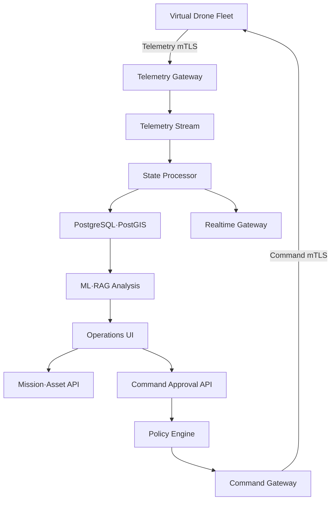
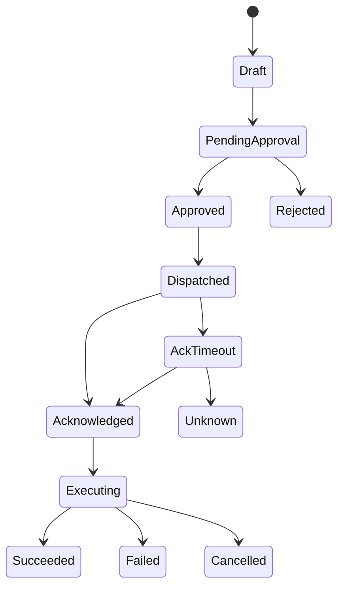

# 시스템 디자인 상세

## 1. 설계 목표

AeroOps는 비행제어기를 대체하지 않는다. 기체 또는 Edge Gateway에서 생성된 운용 상태를 조직 수준에서 수집·가시화하고, 승인된 명령을 신뢰성 있게 전달하며, 장애와 배포 이력을 재현하는 상위 관제 플랫폼이다.

품질 속성의 우선순위는 `명령 안전성 > 데이터 정합성 > 장애 복구성 > 관측성 > 성능 > 확장성`이다.

## 2. 논리 아키텍처

## 3. 배포 단위

MVP는 마이크로서비스가 아닌 모듈형 모놀리스와 독립 Worker로 구성한다.

| 배포 단위 | 내부 모듈 | 확장 시 분리 조건 |
|---|---|---|
| `control-api` | 자산, 임무, 명령, 승인, 감사 | 명령 부하 또는 보안 경계가 별도 요구될 때 |
| `telemetry-api` | 수신, 검증, 최신 상태 | 수집량이 API 업무 부하와 충돌할 때 |
| `event-worker` | 경보, timeout, projection | 소비 지연이 지속될 때 |
| `ai-service` | 이상 탐지, RAG, 로컬 LLM | 별도 CPU/GPU 자원 격리가 필요할 때 |
| `simulator` | 기체, 장애 주입, 재동기화 | 부하 시험에서 프로세스 분산이 필요할 때 |
| `web` | React 관제 UI | 독립 정적 배포 |

## 4. 트래픽·용량 가정

- 기본 10대, 확장 시험 100대
- 기본 Telemetry 1 Hz, 단기 부하 시험 10 Hz
- 프레임 평균 1 KB 가정
- 정상 부하: `10 × 1 Hz = 10 msg/s`
- 확장 부하: `100 × 10 Hz = 1,000 msg/s`
- Command는 기체당 분당 수 회 이하의 저빈도 트래픽
- UI는 원본 전체가 아니라 최신 Projection과 중요 이벤트를 구독

MVP 성공 기준은 10대×1 Hz를 20분 이상 처리하고, 로컬 수집→화면 반영 p95를 500 ms 이내로 유지하는 것이다.

## 5. 데이터 일관성

### Telemetry

- At-least-once 수신을 가정한다.
- `(asset_id, boot_id, sequence_no)`를 멱등 키로 사용한다.
- 정규 이벤트는 유일 제약으로 중복 삽입을 막는다.
- `latest_asset_state`는 더 큰 `state_version` 또는 최신 유효 `event_time`만 반영한다.
- 늦은 이벤트는 이력에는 저장하지만 현재 상태를 후퇴시키지 않는다.

### Command

- 분산 환경에서 진정한 exactly-once를 주장하지 않는다.
- 서버는 동일 `command_id`를 재사용하고 기체는 처리 이력을 보존한다.
- 명령 상태 전이와 Outbox 이벤트를 한 DB 트랜잭션으로 기록한다.
- ACK timeout은 `FAILED`가 아니라 `ACK_TIMEOUT/UNKNOWN`으로 분류한다.

## 6. 상태 머신

모든 전이는 `actor`, `reason`, `occurred_at`, `correlation_id`, `previous_state`, `new_state`를 감사 로그로 남긴다.

## 7. 장애와 복구

| 장애 | 탐지 | 처리 | 복구 증거 |
|---|---|---|---|
| Redis 중단 | health check, 소비 지연 | DB Outbox 보존, 명령 전달 제한 | 재시작 후 미발행 Outbox 처리 |
| PostgreSQL 중단 | 연결 실패율 | 수신 제한·명령 생성 중단 | 데이터 손실 없이 재연결 |
| Telemetry 단절 | last_seen 경과 | CONNECTED→STALE→DISCONNECTED | Snapshot 재동기화 |
| ACK 손실 | ACK deadline | 재실행 금지, 상태 조회 | last_processed_command_id 대조 |
| AI 서비스 중단 | inference error | 규칙 기반 Fallback | fallback_count와 복구 시간 |
| 잘못된 모델 | 품질·Drift 경보 | 이전 Registry alias로 Rollback | model_version 변경 감사 로그 |

## 8. Cache와 실시간 전달

- Redis는 최신 상태 Cache와 Stream에 사용하지만 영구 진실의 원천은 PostgreSQL이다.
- WebSocket 재접속 시 `last_event_id` 이후 이벤트를 복구하거나 최신 Snapshot을 다시 받는다.
- 느린 Client에는 Queue 상한을 적용하고 오래된 위치 업데이트를 합쳐 최신 상태만 남긴다.
- 경보와 명령 상태 이벤트는 합치지 않고 전달을 보장한다.

## 9. API 설계 규칙

- 외부 계약은 `/api/v1`로 버전 관리한다.
- Mutation 요청은 `Idempotency-Key`를 지원한다.
- `trace_id`, `correlation_id`, `operation_session_id`를 전파한다.
- 오류는 `error_code`, `message`, `retryable`, `details` 구조로 통일한다.
- 기체 API와 사용자 API는 인증 체계와 네트워크 경계를 분리한다.

## 10. SLO와 관측성

| SLI | 목표 |
|---|---|
| Telemetry 수신 성공률 | 정상 시나리오 99.9% 이상 |
| 수집→UI p95 | 500 ms 이하 |
| Command 상태 추적 | 승인된 명령 100% 감사 가능 |
| 잘못된 최신 상태 후퇴 | 0건 |
| 중복 Command 실행 | 0건 |
| 재동기화 성공률 | 정의된 시험 시나리오 100% |

메트릭, 구조화 로그, Trace는 동일 `correlation_id`로 연결한다.

## 11. 주요 ADR

1. MVP는 Kubernetes 대신 Docker Compose를 사용한다.
2. Kafka 대신 Redis Streams로 시작하되 채널과 소비자 그룹은 분리한다.
3. 이벤트 소싱 전체 도입 대신 원본 이벤트+Projection 패턴을 사용한다.
4. 실제 비행역학보다 관제·통신 검증에 충분한 운동 모델을 사용한다.
5. LLM 출력은 의사결정 자료이며 시스템의 진실 원천이 아니다.

## 12. 운용 요구사항 추적

모든 핵심 기능은 `운용 문제 → 시스템 요구사항 → 구현 컴포넌트 → 시험 → 증거`로 추적한다.

| 요구사항 | 불변조건 | 구현 위치 | 대표 시험 |
|---|---|---|---|
| REQ-STATE-01 | 오래된 자료가 최신 상태를 덮어쓰지 않음 | State Processor | 지연·역순 주입 |
| REQ-CONT-02 | 단절 중 만료 명령을 재접속 후 실행하지 않음 | Simulator·Sync | Disconnect/Resync |
| REQ-AUTH-03 | 현재 통제권 없는 주체의 명령은 거부 | Control API·Policy | 인계 전후 경합 |
| REQ-CMD-04 | ACK와 목표 상태 달성을 분리 | Command State Machine | ACK 손실·효과 검증 |
| REQ-MSN-05 | 임무 가능성 판단의 가정·여유량을 기록 | Mission Evaluator | 배터리·경로 조합 |
| REQ-QOS-06 | 부하 중 명령·긴급 경보의 지연 상한 보호 | Streams·Workers | 혼합 트래픽 부하 |
| REQ-ALERT-07 | 동일 원인의 반복 경보를 사건으로 묶음 | Alert Correlator | 복합 장애 시나리오 |
| REQ-AUDIT-08 | 당시 코드·정책·모델·행위를 재구성 가능 | Event Log·Registry | Replay·Lineage 조회 |

구현 완료 여부는 화면 존재가 아니라 각 요구사항의 시험 결과와 증거 Artifact로 판단한다.
