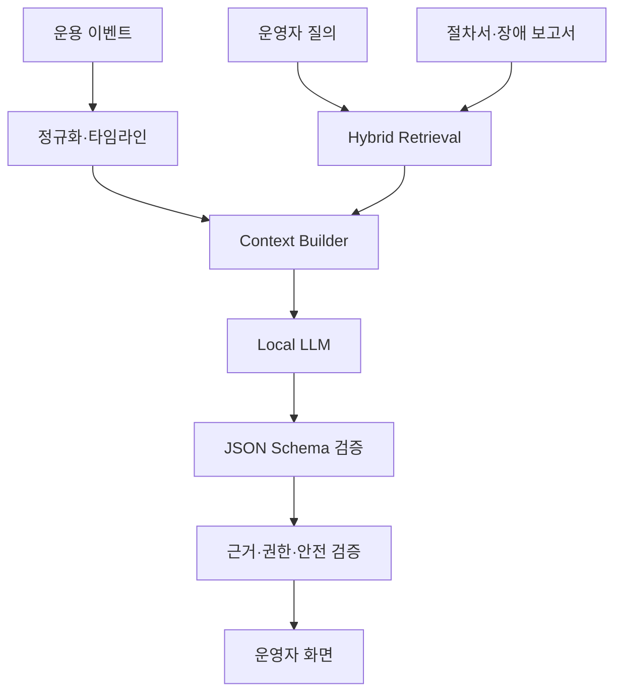

# LLM·MLOps 아키텍처

## 1. 적용 목적

LLM은 외부 상용 API를 호출하는 장식 기능이 아니라, 로컬 오픈 가중치 모델과 자체 검색·평가 파이프라인을 이용하여 운용 이벤트를 설명하는 분석 컴포넌트다. ML은 통신·센서·기체 상태의 정량적 이상을 탐지한다.

## 2. 책임 분리

| 계층 | 책임 | 금지 사항 |
|---|---|---|
| 규칙 엔진 | 안전 임계값, 상태 전이, 명령 허용 판단 | LLM 결과에 의해 우회 불가 |
| ML 이상 탐지 | 패킷 손실·배터리·GPS·지연 이상 점수 | 단독으로 위험 명령 실행 금지 |
| RAG | 절차서·과거 장애·배포 문서 검색 | 권한 없는 문서 검색 금지 |
| LLM | 타임라인 요약, 원인 후보, 대응 절차 설명 | Command Gateway 직접 호출 금지 |
| 운영자 | 근거 검토와 승인 | 감사 기록 없는 실행 금지 |

## 3. 로컬 LLM 파이프라인



### 권장 구현

- 추론: `llama.cpp`와 1.5B~4B급 4-bit GGUF 모델
- 임베딩: 소형 다국어 Sentence Transformer
- 검색: PostgreSQL FTS + pgvector
- 결합: Reciprocal Rank Fusion
- 출력: JSON Schema constrained decoding
- 서비스: Python FastAPI, 별도 `ai-service` 프로세스

기반 모델 자체를 처음부터 사전학습하지 않는다. 직접 구현 대상은 문서 파싱, Chunking, 메타데이터 필터, Hybrid Retrieval, Reranking, Context 조립, 구조화 출력, 평가, 캐시, 안전 검증이다.

## 4. LLM 기능

1. 장애 이벤트 타임라인 자동 요약
2. 통신 단절·ACK timeout 원인 후보 제시
3. 운용 절차서와 관련 장애 사례 검색
4. 자연어 질의를 허용된 조회 DSL로 변환
5. 시뮬레이션 종료 후 장애 보고서 초안 생성

모든 답변은 `evidence_event_ids`, `document_ids`, `knowledge_snapshot_id`, `model_version`, `prompt_version`을 포함한다. 근거가 부족하면 `INSUFFICIENT_EVIDENCE`로 응답한다.

## 5. ML 이상 탐지

### Feature

- 최근 10/30/60초 패킷 손실률
- p50/p95 수신 지연과 Jitter
- 역순 도착 비율
- RSSI 변화율
- 배터리 감소율과 전압 변화
- GPS 이동 거리·속도·가속도 불연속
- Command ACK와 실행 시간

### 모델 단계

1. 임계값과 상태 머신 기준선
2. Rolling Z-score와 EWMA
3. Isolation Forest
4. 선택 확장: XGBoost 또는 경량 Autoencoder

모델이 없거나 실패하면 규칙 기반 기준선으로 전환한다. ML 경보에는 모델 점수뿐 아니라 사용된 Feature와 규칙 결과를 같이 표시한다.

## 6. MLOps 수명주기

```text
simulation_run → dataset snapshot → data validation → feature build
→ train/evaluate → MLflow Tracking → Model Registry → approval
→ shadow → canary → production/rollback
```

| Artifact | 필수 메타데이터 |
|---|---|
| 데이터셋 | schema, 기간, scenario, seed, hash |
| ML 모델 | algorithm, hyperparameters, metrics, feature schema |
| LLM | base model digest, quantization, context length |
| RAG | embedding model, chunk policy, index snapshot, top-k |
| Prompt | template version, output schema, safety policy |
| 배포 | Git SHA, image digest, model alias, deployed_at |

## 7. 평가

### ML 평가

- Precision, Recall, F1, False Alarm Rate
- 탐지 지연과 시나리오 유형별 Confusion Matrix
- 규칙 Fallback 비율

### RAG·LLM 평가

- Retrieval Recall@K, MRR
- 근거 이벤트·문서 일치율
- JSON Schema 통과율
- 근거 없는 주장 비율
- 위험 Command 직접 생성 시도 차단률
- Prompt Injection 시험 통과율
- 운영자 채택·수정·기각률

최소 평가 세트는 정상, 패킷 손실, 역순, 단절, ACK 손실, 재동기화 충돌을 포함한 30개 사례로 만든다.

## 8. 배포와 Rollback

- 새 버전은 과거 이벤트 Replay로 Offline 평가한다.
- Shadow 모드에서는 결과만 기록하고 운영 판단에는 사용하지 않는다.
- 기준 통과 후 일부 시나리오에 Canary 적용한다.
- 오류율·지연·품질 하락 시 이전 승인 버전으로 되돌린다.
- 모델 파일과 Embedding Index는 Hash 검증 후 로드한다.

## 9. 노트북 자원 제한 대응

- 학습보다 공개 모델의 로컬 추론과 서빙에 집중한다.
- Context와 동시 요청 수를 제한한다.
- LLM은 요청형 분석에 사용하고 1 Hz Telemetry마다 호출하지 않는다.
- 이상 탐지는 경량 통계/트리 모델을 사용한다.
- 대규모 LoRA 학습은 MVP에서 제외한다.
