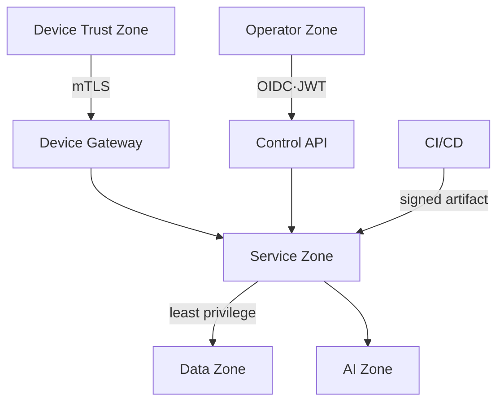

# DevSecOps·보안 아키텍처

## 1. 위협 모델

보호 대상은 기체 신원, Command 무결성, Telemetry 출처, 운용자 계정, 인증서·Secret, 모델 Artifact, 감사 로그다. 주요 위협은 위장 기체, Replay, 권한 상승, Command 변조, 취약 이미지, 의존성 공급망 공격, 모델 교체, Prompt Injection, 로그 삭제다.

## 2. Zero Trust 원칙

- 네트워크 위치를 신뢰 근거로 사용하지 않는다.
- 사용자·서비스·기체를 각각 인증한다.
- 요청마다 최소 권한과 자원 범위를 검증한다.
- 기체 ID와 인증서 Subject/SAN을 매핑한다.
- 모든 고위험 명령과 권한 변경을 감사한다.

## 3. 신뢰 경계

Telemetry 인증 주체가 Command를 승인할 수 없고, AI 서비스가 Command Gateway 자격 증명을 갖지 않도록 권한을 분리한다.

## 4. 기체와 명령 보안

- 기체별 X.509 인증서와 mTLS
- 인증서 발급·갱신·만료·폐기 상태 관리
- `command_id`, `issued_at`, `expires_at`, `nonce`, `target_asset_id`
- 동일 Command Replay 차단
- 위험 명령의 요청자·승인자 분리
- 명령 Payload Hash와 상태 전이 감사
- 폐기 인증서 또는 다른 asset ID 인증서의 연결 거부

MVP PKI는 개발 CA와 기체별 인증서를 사용한다. 운영 확장에서는 Offline Root CA와 Intermediate CA, 짧은 수명 인증서, 자동 Rotation을 고려한다.

## 5. CI/CD 보안 게이트

| 단계 | 검사 | 실패 정책 |
|---|---|---|
| Commit | Secret Scan, Lint | Secret 탐지 시 차단 |
| Pull Request | SAST, 단위·보안 테스트 | High 이상 신규 이슈 차단 |
| Dependency | SCA, License 확인 | Critical 취약점 차단 |
| Image Build | 최소 이미지, non-root | root 실행·불필요 패키지 차단 |
| Image Scan | OS·Library CVE | 예외 없는 Critical 차단 |
| IaC/Compose | 공개 포트·권한·평문 Secret | 정책 위반 차단 |
| SBOM | CycloneDX/SPDX 생성 | Artifact에 첨부 |
| Sign | Cosign 이미지·Artifact 서명 | 미서명 배포 차단 |
| Deploy | 서명·Digest·환경 정책 검증 | 불일치 시 차단 |

권장 도구는 GitHub Actions, Gitleaks, Semgrep 또는 CodeQL, Trivy, Syft, Cosign, Dependabot/Renovate다. 도구 개수보다 실제 차단 규칙과 예외 승인 기록이 중요하다.

Workflow 선언은 YAML로 유지하되 반복되는 배포 로직은 Go `opsctl`과 `release-controller`에 둔다. 이 도구는 환경 사전점검, SBOM·Cosign 서명·OCI digest 검증, Health Gate, Rollback과 증거 Bundle 생성을 담당한다. CI Runner와 운영 배포 주체의 Credential은 분리한다.

### 언어별 보안 검사

| 영역 | 필수 검사 |
|---|---|
| Kotlin/Spring | Gradle dependency scan, SAST, ArchUnit, 보안·권한 통합시험 |
| Rust | `cargo audit`, `clippy`, unsafe 사용 검토 |
| C++ | compiler warning-as-error, sanitizer, 정적 분석, fuzzing |
| Python | dependency scan, type/lint, 모델·pickle 안전성 검사 |
| Go | `govulncheck`, staticcheck, 배포 상태 머신 시험 |
| React/TypeScript | dependency scan, typecheck, XSS/CSP 시험 |

## 6. 모델 공급망 보안

- 모델 출처, 라이선스, 원본 URL, Hash 기록
- GGUF·ONNX·pickle Artifact를 허용 목록으로 관리
- 안전하지 않은 역직렬화 형식 사용 제한
- 모델·Tokenizer·Embedding Index의 Digest 검증
- MLflow 등록 모델과 배포 이미지 연계
- 모델 변경 PR에서 평가 결과와 보안 검사 요구
- 승인되지 않은 모델 Alias의 Production 로딩 차단

## 7. LLM 보안

- RAG 문서 ACL과 출처 Allowlist
- 시스템 지시, 검색 문서, 사용자 입력 구분
- 검색 문서 안의 명령을 신뢰하지 않음
- JSON Schema와 허용된 Action Type 검증
- 읽기 전용 Query DSL만 지원
- 자유 SQL과 Shell 실행 금지
- Secret을 Prompt에 포함하지 않음
- AI 서비스에 Command 발행 권한을 주지 않음

## 8. Secret·런타임 보안

- `.env`는 로컬 전용이며 저장소에 Commit하지 않는다.
- CI Secret과 런타임 Secret을 분리한다.
- 로그·Trace에서 Token, Cookie, Private Key를 마스킹한다.
- 컨테이너 non-root, read-only filesystem, capability drop을 적용한다.
- 서비스별 DB 계정과 최소 권한을 적용한다.
- Rate Limit, Payload 크기 제한, 입력 스키마 검증을 적용한다.

## 9. 보안 시험

1. 인증서 없는 기체 연결 거부
2. 폐기 인증서 연결 거부
3. 다른 기체 인증서를 사용한 asset 위장 거부
4. 만료·Replay Command 거부
5. 미승인 위험 명령 Dispatch 거부
6. Prompt Injection이 Command를 생성하지 못함
7. 변조된 모델 Hash 로딩 거부
8. 미서명 컨테이너 배포 차단
9. 로그의 Secret 마스킹 확인
10. 취약 Dependency 시험 PR 차단

## 10. 사고 대응

`탐지 → 격리 → 자격 증명 폐기 → 안전 상태 확인 → 증거 보존 → 복구 → 사후 분석` 순서로 처리한다. 기체 인증서, 사용자 Token, 서비스 Secret, 모델 Artifact 각각의 Runbook을 둔다.
