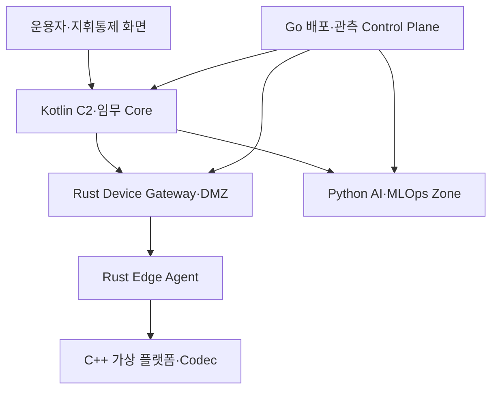

# 방산 특화 DDD·언어별 책임 아키텍처

## 1. 설계 방향

AeroOps는 일반 IoT 대시보드가 아니라 임무, 지휘통제, 통제권, 통신 열화, 안전 정책과 사후 추적성을 핵심 언어로 사용하는 무인체계 관제 플랫폼이다. 공개·비기밀 모의 데이터만 사용하며 무장·표적화·공격 자동화는 다루지 않는다.

## 2. 방산 운용 계층

명령 Control Plane과 Telemetry Data Plane은 인증 주체, 채널, ACL, 우선순위와 보존 정책을 분리한다. AI Zone은 운용 데이터를 읽고 분석 결과를 기록할 수 있지만 명령 채널에는 접근하지 못한다.

## 3. 언어별 단일 책임

| 언어 | 소유 영역 | 대표 산출물 | 사용하지 않는 영역 |
|---|---|---|---|
| Kotlin | 임무·자산·지휘통제 도메인, API, 상태 머신, 정책·감사 | Spring Boot/Modulith Core | 장비 Wire Protocol 구현, 모델 학습 |
| React+TypeScript | 관제 UI, 지도·3D·Timeline, 승인 UX | Web Console | 안전 판정의 최종 결정 |
| Python | Feature, 학습·평가, MLflow, RAG·LLM orchestration | `ai-service`, training pipeline | 실시간 Command 경로 |
| C++ | 결정적 시뮬레이터, 고성능 Codec·Replay, 선택적 llama.cpp binding | simulator, replay tool | 업무 권한·승인 규칙 |
| Rust | Edge 통신 Agent, framing, mTLS, store-and-forward, protocol validation | edge-agent, device-gateway | 임무 Aggregate 소유 |
| Go | CI/CD 보조 CLI, release controller, health/metric exporter, 배포 검증 | opsctl, deploy-verifier | 핵심 임무 규칙 |

GitHub Actions·컨테이너 선언 자체는 YAML을 사용하되, 재사용 가능한 배포 검증·운영 자동화 로직은 Go 바이너리로 구현한다.

## 4. 컨텍스트 맵

| 상류 컨텍스트 | 하류 컨텍스트 | 관계·계약 |
|---|---|---|
| Mission Operations | Command & Control | Published Language: mission/phase ID |
| Operational Picture | Mission Readiness | 도메인 이벤트: 관측값·Freshness·품질 |
| Safety & Policy | Command & Control | Customer/Supplier: versioned decision contract |
| Communications Resilience | Operational Picture | Anti-Corruption Layer: Wire frame→Observation |
| Command & Control | Communications Resilience | Command envelope·expiry·nonce·priority |
| Incident Management | AI Analysis | 읽기 전용 사건 Snapshot·Evidence ID |
| Deployment Registry | 모든 컨텍스트 | Conformist: deployment/policy/schema version |

## 5. 네트워크·보안 구역

| 구역 | 허용 구성요소 | 주요 통제 |
|---|---|---|
| Platform/Edge | C++ simulator, Rust edge-agent | 기체별 인증서, 로컬 Failsafe, 제한 Buffer |
| Device DMZ | Rust gateway | mTLS 종단, Replay 방지, Payload 한도, rate limit |
| Mission Service | Kotlin Spring Core | OIDC/RBAC, 통제권, 이중 승인, 감사 |
| Data | PostgreSQL/PostGIS, Redis | 서비스별 계정, 비공개 Endpoint, append-only Audit |
| AI | Python inference/training, MLflow | 읽기 전용 운용 입력, 모델 Hash, 명령 Credential 금지 |
| Management | Go ops tools, Registry, CI Runner | 서명 검증, 승인된 Artifact, 분리된 운영 권한 |

연결이 제한된 환경을 고려해 컨테이너 이미지·SBOM·모델·패키지의 오프라인 반입 절차, Hash/서명 검증, 내부 Registry 승격 절차를 정의한다.

## 6. DDD 완료 기준

1. Ubiquitous Language 사전에 용어와 금지 동의어가 기록된다.
2. Aggregate별 불변조건과 트랜잭션 경계가 시험으로 고정된다.
3. 컨텍스트별 테이블 소유자가 명시되고 교차 쓰기가 없다.
4. 외부 장비 계약은 Anti-Corruption Layer를 통과한다.
5. Context Event에는 schema version과 correlation ID가 있다.
6. ArchUnit·Spring Modulith 시험이 금지 의존성을 차단한다.
7. 요구사항–도메인 규칙–시험–배포 증거가 추적된다.
