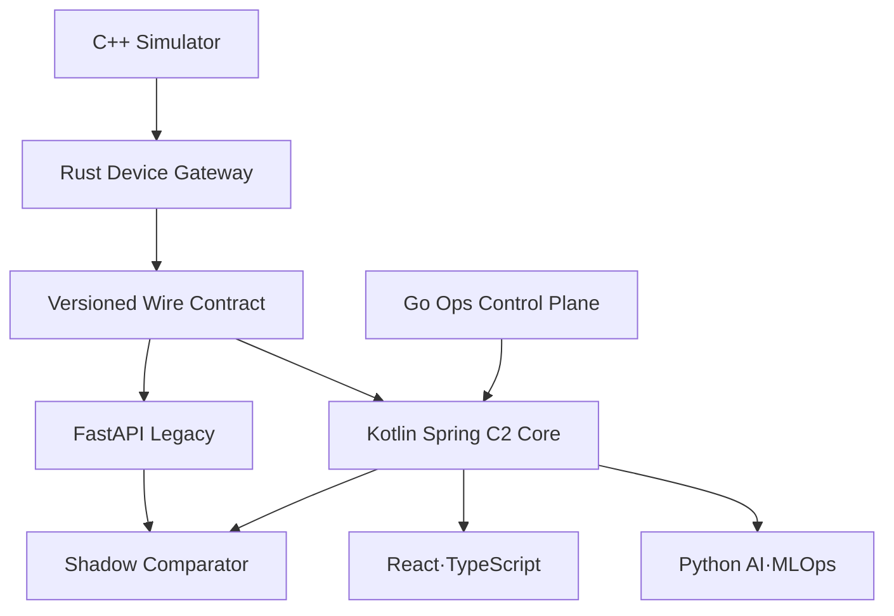

# 점진적 전환 아키텍처

## 1. 전환 전략

Big-bang rewrite 대신 Strangler 패턴을 사용한다. React와 장비 계약 앞에 호환 경계를 두고, 조회 Projection부터 Kotlin으로 옮긴 다음 Mission, Command 순으로 System of Record를 전환한다. 각 단계는 Shadow 비교, Canary, Cutover, Rollback을 갖는다.

## 2. 목표 실행 단위

| 실행 단위 | 언어·기술 | 책임 |
|---|---|---|
| `web-console` | React+TypeScript | 상황도, 승인, Replay, 근거 표시 |
| `c2-core` | Kotlin+Spring Boot/Modulith | Mission, C2, 정책, 상황도, 감사 |
| `device-gateway` | Rust+Tokio | mTLS, framing, QoS, bounded queue, 재접속 |
| `flight-simulator` | C++20+CMake | 운동·에너지 모델, 장애 주입, 결정적 Replay |
| `ai-service` | Python | Feature, ML inference/evaluation, RAG·LLM |
| `ml-pipeline` | Python+MLflow | Dataset snapshot, 학습·평가·Registry |
| `opsctl` | Go | 사전점검, 배포, 서명·Digest 확인, Rollback |
| `ops-exporter` | Go | 배포·Gateway·모델 운영 Metric Export |

## 3. 단계별 System of Record

| 단계 | FastAPI | Kotlin | 전환 판정 |
|---|---|---|---|
| 0 기준선 | 모든 업무 쓰기 | 없음 | Replay baseline 고정 |
| 1 Foundation | 계속 운영 | Read-only Skeleton | Health·DB 연결 |
| 2 Projection | 원본 Event 쓰기 | Shadow Projection | 상태 결과 비교 |
| 3 Mission | Mission 읽기 호환 | Mission 쓰기 원장 | API 계약 회귀 |
| 4 Command | Shadow 상태 계산 | Command 쓰기 원장 | 동시성·ACK 시험 |
| 5 Gateway | Kotlin으로 Event 전달 | 통신 독립 | Rust 장애 시험 |
| 6 AI/Ops | Legacy AI 없음 | AI 결과 참조 | 격리·Fallback 시험 |
| 7 Cutover | Read-only/Fallback | 전체 System of Record | Canary·Rollback |
| 8 종료 | Archive | 단독 운영 | 제거 게이트 통과 |

## 4. 데이터 이전

- 기존 Alembic Migration 결과를 Flyway `baselineVersion`으로 등록한다.
- 기존 테이블을 즉시 이름 변경하지 않고 Context별 소유권부터 문서화한다.
- Kotlin JPA Entity와 Python SQLAlchemy Model의 Dual Write는 금지한다.
- 전환 중 한 Context의 쓰기 주체는 항상 하나만 둔다.
- 다른 Context에는 Outbox Event 또는 공개 Query Port로 정보를 전달한다.
- Shadow Projection은 별도 schema/table을 사용하고 결과 비교 후 승격한다.

## 5. API·이벤트 호환

- React가 사용하는 기존 REST/WebSocket 계약을 Contract Test로 동결한다.
- Kotlin Adapter가 기존 응답을 먼저 호환하고, 새 `/api/v2`는 도메인 용어와 오류 계약을 개선한다.
- Wire Event는 `schema_version`, `asset_id`, `boot_id`, `sequence_no`, `event_time`, `received_at`, `correlation_id`를 필수로 한다.
- Protobuf 도입 시 JSON 계약을 즉시 제거하지 않고 Adapter에서 양쪽을 지원한다.

## 6. Cutover와 Rollback

1. 과거 Event Replay로 상태·경보·명령 전이를 비교한다.
2. 운영 쓰기는 FastAPI, Kotlin은 Shadow로 실행한다.
3. Context 단위로 Kotlin 쓰기를 활성화하고 FastAPI 쓰기를 차단한다.
4. 오류율·지연·불변조건 위반을 Go Health Gate에서 판정한다.
5. 실패 시 Routing과 쓰기 권한을 이전 주체로 되돌린다.
6. DB Migration은 Expand→Migrate→Contract 순으로 수행한다.

## 7. 방산 특화 설계 통제

- Platform/Edge, Device DMZ, Mission Service, Data, AI, Management Zone을 분리한다.
- 명령 경로는 Telemetry 폭주와 독립된 Queue·Credential·SLO를 가진다.
- AI Zone에는 Command Credential을 발급하지 않는다.
- 제한망에서는 내부 Registry와 승인된 SBOM·서명·Hash를 사용한다.
- 시간 동기화 상태와 시계 불확실성을 Event 품질에 포함한다.
- 통제권 인계, 이중 승인, 정책 버전, 운용 Session을 모든 명령 증거에 연결한다.
